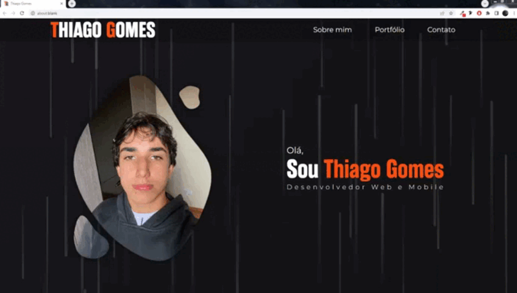

<h1 align="center">
    
    
My Portfolio

</h1>

## 👦 About

100% responsive and intuitive website where the visitor can get information from me, send a message directly to my email box and access my social networks.

This portfolio was created in 2023 and has not yet been refactored. Its information, experience and projects do not represent my current professional work. As additional context, I built the site by hand before generative AI tools became widely used.

Access my portfolio through [this link](https://thiagomes07.github.io/myPortfolio/)!

---

## 💻 Technologies

* HTML5;
* CSS3;
* Javascript.

---

## 🌐 Demonstration

    
    

